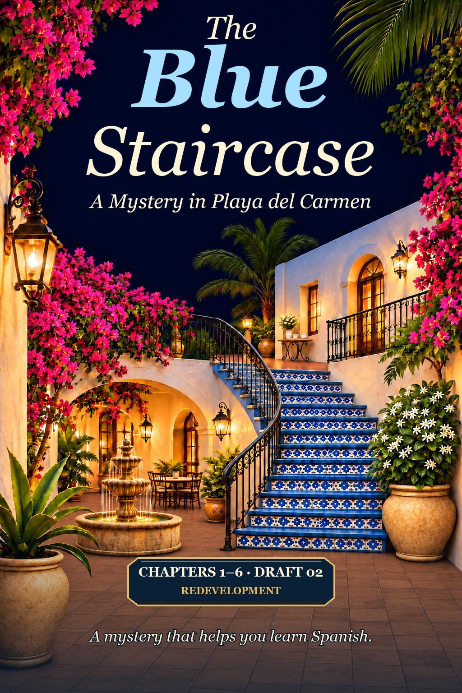
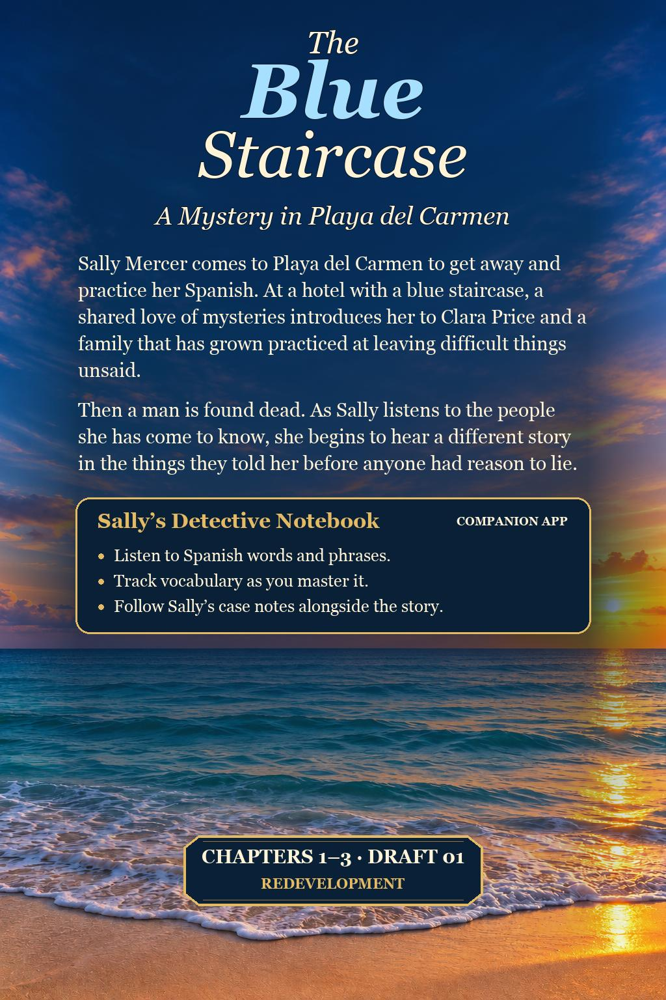

# The Blue Staircase Companion App

  

  

**WORK IN PROGRESS · Companion v0.6.0 · Notebook for Chapters 1–6 · Review Draft 01**

I started this as a personal project for fun and to help my wife learn Spanish in a fun way based on a wish she had to learn Spanish while reading a mystery. I’m sharing the draft and companion app for anyone curious about the story and the ideas behind it. The preview is free, and I have no plans to market it commercially.

## About the book

A long-overdue vacation in Playa del Carmen turns into a mystery surrounding a guest's death for Sally Mercer and her husband Nate. The Mexican Spanish Sally came to practice becomes part of how she follows clues and makes sense of what people tell her. *The Blue Staircase: A Mystery in Playa del Carmen* is a cozy mystery with Spanish woven into the story.

  
  

## Read the Working Draft

- **Read in the companion.** Open the [interactive Reader](https://natsteff.github.io/the-blue-staircase-companion/reader.html) and tap underlined Spanish words and phrases to hear them in context. Use **Aa** for font size and theme. The Reader saves your place and bookmarks in your browser.
- **Read in your preferred app.** [Download The Blue Staircase — Chapters 1–6 · Review Draft 01](https://natsteff.github.io/the-blue-staircase-companion/books/The%20Blue%20Staircase%20-%20Chapters%201-6%20-%20Review%20Draft%2001.epub) for Apple Books, Kindle, or another reading app. Switch back to the companion whenever you want to listen or practice.

The EPUB and companion are synchronized to Chapters 1–6, Review Draft 01. The EPUB includes edition-matched covers and a **Back Cover** entry at the end of the table of contents. The [earlier Chapters 1–2 preview](https://natsteff.github.io/the-blue-staircase-companion/books/The_Last_Witness_-_Working_Draft_v02.epub) is available under its former title, *The Last Witness*.

This free preview is an unfinished manuscript. The chapters, translations, and covers may change substantially.

**Read on iPhone or iPad.** Download the EPUB, find it in **Files → Downloads**, then choose **Share → Books** for Apple Books or **Share → Kindle** for Kindle. Kindle may ask you to edit the title and author before sending. [Step-by-step Apple Books and Kindle guide](docs/READING_ON_IPHONE.md)

## Use TBS Companion App

Follow the mystery with **Sally’s Detective Notebook**, hear the Mexican Spanish she encounters, and track the words and phrases you’ve mastered.

Tap the book cover in the app to view both covers. Tap or swipe the cover to flip it. Double-tap the cover or use **Copy Link** to copy this project page.

Start with **Travel Spanish** for 22 practical Mexican Spanish phrases and a quick guide to masculine and feminine nouns and *ser* and *estar*.

Select the last chapter you’ve read. **This Chapter** shows that chapter’s vocabulary and case notes, while **Through Chapter** includes earlier chapters. In **Spanish**, toggle **Story Order / A–Z**. **This Chapter → Story Order** places selected evidence where Sally encounters it. Meanings stay hidden until the story reveals them.

Practice with **Listen** at regular speed or **Slow** at 70% speed. Use **Hide Mastered** in Spanish or Traveler Phrases. In **Case Notes**, switch between **Handwritten** and **Standard Font**.

Choose **Quiz Me** at the top of **Spanish** or **Travel Spanish** to review mastered phrases from both tabs. Pick English to Spanish, Spanish to English, or Mixed, select up to 50 questions per round, then choose **Multiple Choice** or **Type or Speak**. The quiz includes setup help for iPhone and Android with Gboard.

Mastery is saved in your current browser. On mobile, add **TBS Companion** to your home screen. The traveler guide, chapter notebooks, and recordings are available offline after the app finishes downloading them. Reopen the app while online to pick up updates automatically. [Open TBS Companion App](https://natsteff.github.io/the-blue-staircase-companion/)

## What to expect

Future working drafts will be cumulative, with the earlier chapters and new material in one EPUB. The EPUB and companion app have separate release schedules. The novel is still being written and revised, with no announced publication date.

## Feedback

Corrections, usability reports, pronunciation notes, and editorial feedback are welcome. Include the draft version and chapter, label spoilers clearly, and keep plot details out of issue titles. [GitHub Issues](https://github.com/natsteff/the-blue-staircase-companion/issues)

## Credits and rights

Written by Nate and OpenAI. The cover art, illustrations, and companion app assets are part of this project. Public repository access does not by itself grant permission to redistribute the manuscript.

## Developer documentation

See the [development guide](docs/DEVELOPMENT.md) for local setup, audio generation, deployment, versioning, and future chapter updates.
