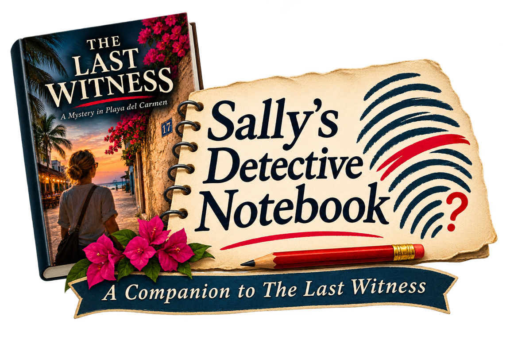
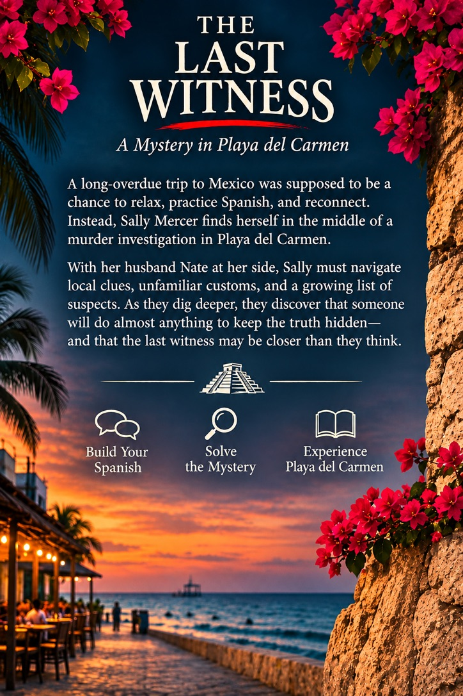

# Sally’s Detective Notebook

  

  

**WORK IN PROGRESS · Novel working draft v02 · Chapters 1–2 of 24 planned**

## About the book

A long-overdue vacation in Playa del Carmen turns into a murder investigation for Sally Mercer and her husband Nate. The Mexican Spanish Sally came to practice becomes part of how she follows clues and makes sense of what people tell her. *The Last Witness: A Mystery in Playa del Carmen* is a cozy mystery with Spanish woven into the story.

  
  

## Read the Working Draft

**[Download EPUB — Working Draft v02 (Chapters 1–2)](https://natsteff.github.io/the-last-witness-companion/books/The_Last_Witness_-_Working_Draft_v02.epub)**

This free preview is an unfinished manuscript. The chapters, translations, and covers may change substantially. To read the EPUB on a compatible Kindle, import it as a personal document. Personal documents may not be available through Family Library. [Amazon Send to Kindle](https://www.amazon.com/sendtokindle)

## Try Sally’s Detective Notebook

Read a chapter, then select that chapter in the companion. Review Sally’s observations, theories, and unanswered questions without going past where you’ve read. Practice Mexican Spanish with **Listen** or **Slow**, tick **Mastered** when you know an entry, and use **Hide mastered** to focus on what you’re still practicing.

Mastery is saved in your current browser. On mobile, add **TLW Notebook** to your home screen. Both chapter notebooks and their recordings are available offline after the first successful visit. [Open TLW Notebook](https://natsteff.github.io/the-last-witness-companion/)

## What to expect

Future working drafts will be cumulative, with the earlier chapters and new material in one EPUB. Companion content will be synchronized to the corresponding edition. The novel is still being written and revised, with no announced publication date.

## Feedback

Corrections, usability reports, pronunciation notes, and editorial feedback are welcome. Include the draft version and chapter, label spoilers clearly, and keep plot details out of issue titles. [GitHub Issues](https://github.com/natsteff/the-last-witness-companion/issues)

## Credits and rights

Written by Nate and OpenAI. The cover art, illustrations, and companion app assets are part of this project. Public repository access does not by itself grant permission to redistribute the manuscript.

## Developer documentation

See the [development guide](docs/DEVELOPMENT.md) for local setup, audio generation, deployment, versioning, and future chapter updates.
